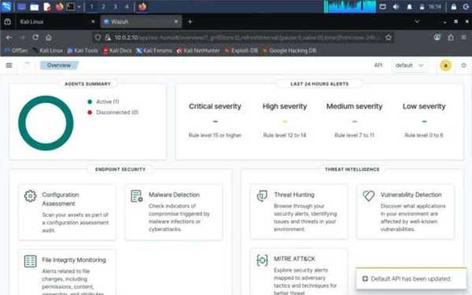
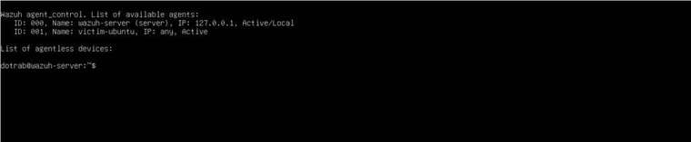
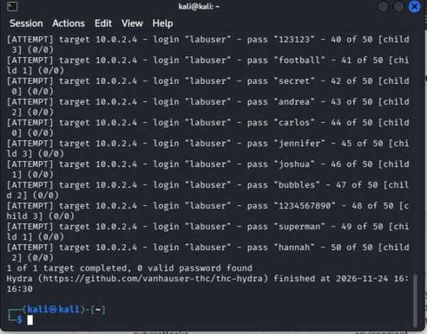
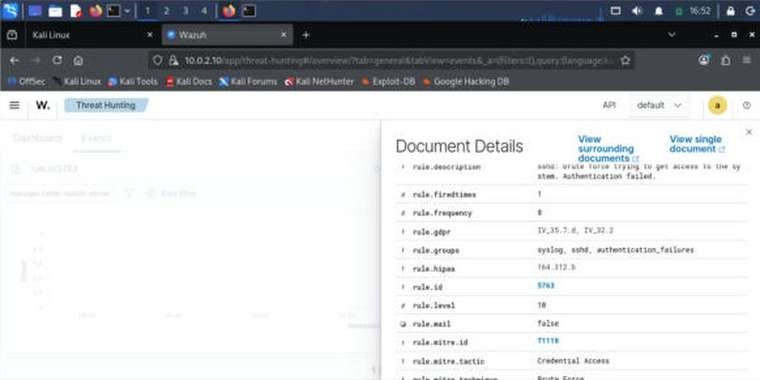
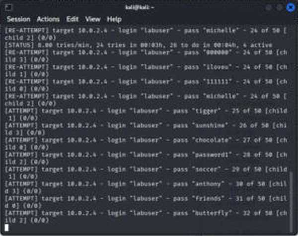
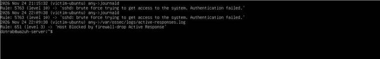

# Automated SSH Brute-Force Containment with Wazuh (Home Lab)

**Author:** Rabihu Hussein · **Built:** November 2026 · **Stack:** Wazuh 4.14.10 (SIEM/XDR), Ubuntu Server 24.04, Kali Linux, Hydra, iptables, Oracle VirtualBox

A home-lab SOC use case in which an SSH brute-force attack is **detected, mapped to MITRE ATT&CK, and blocked automatically at the host firewall** without an analyst stepping in.

---

## Results

| Metric | Before auto-block | After auto-block |
|---|---|---|
| Hydra attack rate against `labuser` | ~50 tries/min, all 50 passwords tried freely | dropped to **8 tries/min**, with Hydra stuck on `[RE-ATTEMPT]` |
| Wazuh response | Rule 5763 alert only | Rule **5763** (detection), then rule **651** "Host Blocked by firewall-drop Active Response" |
| Detection-to-block time | n/a (no response) | **Same second**: both rules logged at 22:09:38 UTC on the Wazuh server clock |
| Analyst notification | none | Slack `#soc-alerts` got the 5763 alert (00:26:04 UTC) and the 651 "Host Blocked" alert (00:26:05 UTC), 1 second apart |

The block lasts 180 seconds and then lifts automatically. Hydra speeds back up when it ends, which shows the timeout is working.

---

## Lab architecture

```
 kali-attacker ──(Hydra SSH brute force)──▶ victim-ubuntu 10.0.2.4
   (attacker)                                 │  Wazuh agent 4.14.10
        ▲                                     │  reads /var/log/auth.log
        │                                     ▼
        └──── iptables DROP ◀── firewall-drop ── wazuh-server 10.0.2.10
              (active response)                  manager + indexer + dashboard
```

All three VMs sit on one isolated VirtualBox NAT Network, `SOC-Lab` (10.0.2.0/24).

| VM | OS | vCPU / RAM / Disk | Role |
|---|---|---|---|
| wazuh-server | Ubuntu Server 24.04 | 4 / 8 GB / 50 GB | Wazuh all-in-one (manager, indexer, dashboard, filebeat) |
| victim-ubuntu | Ubuntu Server 24.04 | 1 / 1.5 GB / 25 GB | SSH target with the Wazuh agent |
| kali-attacker | Kali Linux 2026.3 | 2 / 2 GB | Attacker (Hydra) and dashboard browser |

---

## How it works

1. **Collect:** the Wazuh agent on the victim forwards `sshd` authentication logs to the manager.
2. **Detect:** each failed login fires rule 5760 ("sshd: authentication failed", level 5). When enough of them arrive from one source in a short window, Wazuh's correlation fires **rule 5763** ("sshd: brute force trying to get access to the system", **level 10**).
3. **Map:** rule 5763 is tagged **MITRE ATT&CK T1110 (Brute Force)**, tactic Credential Access. It also carries compliance tags: PCI DSS 11.4/10.2.4/10.2.5, NIST 800-53 SI.4/AU.14/AC.7, HIPAA 164.312.b, GDPR IV_35.7.d/IV_32.2, and TSC CC6.1/CC6.8/CC7.2/CC7.3.
4. **Contain:** the active-response rule runs `firewall-drop` **on the agent that raised the alert** (`location local`). That adds an iptables DROP for the attacker's source IP, and Wazuh logs **rule 651**.
5. **Recover:** after `timeout 180` the block is removed automatically.

---

## Configuration

### Active response (`/var/ossec/etc/ossec.conf` on wazuh-server)

```xml
<ossec_config>
  <active-response>
    <command>firewall-drop</command>
    <location>local</location>
    <rules_id>5763</rules_id>
    <timeout>180</timeout>
  </active-response>
</ossec_config>
```

The `firewall-drop` `<command>` ships with Wazuh by default. Restart afterwards with `sudo systemctl restart wazuh-manager`.

### Slack notification

```xml
<ossec_config>
  <integration>
    <name>slack</name>
    <hook_url>https://hooks.slack.com/services/XXX/YYY/ZZZ</hook_url>
    <rule_id>5763,651</rule_id>
    <alert_format>json</alert_format>
  </integration>
</ossec_config>
```

### Victim preparation

```bash
sudo apt-get -y install openssh-server iptables
sudo useradd -m -s /bin/bash labuser    # deliberately weak, lab-only password
sudo sed -i 's/^#*PasswordAuthentication.*/PasswordAuthentication yes/' /etc/ssh/sshd_config
sudo systemctl restart ssh
# Wazuh agent, pinned to the manager's version
wget https://packages.wazuh.com/4.x/apt/pool/main/w/wazuh-agent/wazuh-agent_4.14.10-1_amd64.deb
sudo WAZUH_MANAGER=10.0.2.10 WAZUH_AGENT_NAME=victim-ubuntu dpkg -i ./wazuh-agent_4.14.10-1_amd64.deb
sudo systemctl daemon-reload && sudo systemctl enable --now wazuh-agent
```

### Attack simulation (Kali)

```bash
zcat /usr/share/wordlists/rockyou.txt.gz | head -n 50 > lab-pass.txt
hydra -t 4 -l labuser -P lab-pass.txt -V ssh://10.0.2.4
```

---

## Verification

| Check | Command / location | Result |
|---|---|---|
| Agent connected | `sudo /var/ossec/bin/agent_control -l` and the dashboard Agents summary | `ID: 001, victim-ubuntu, Active` |
| Detection | Dashboard → Threat Hunting → `rule.id:5763` | Level 10, T1110, agent victim-ubuntu |
| Containment | `sudo grep -E "Rule: (5763\|651) " -B2 /var/ossec/logs/alerts/alerts.log` | 5763 and 651 at the same timestamp |
| Containment (victim side) | `sudo iptables -L -n` and `sudo tail /var/ossec/logs/active-responses.log` | DROP rule for the attacker IP while the block is active |

---

## Troubleshooting log (real issues hit during the build)

| Problem | Root cause | Fix |
|---|---|---|
| Slack integration posted nothing; `integrations.log` showed "Invalid URL ''" | The `<hook_url>` was written empty | Re-inserted the webhook URL and restarted the manager |
| Wazuh install failed with "No space left on device" | Ubuntu's installer allocated only 24 GB of the 50 GB disk to the root LV | Extended the LV with `lvextend` and resized the filesystem |
| Reinstall failed: "manager package could not be removed" | dpkg left broken by the disk-full failure | Force-purged the package, removed `/var/ossec`, clean reinstall |
| Installer hung for 35+ min; kernel soft-lockup messages | A pre-installed **MicroK8s** snap was starving the VM's CPU | `snap stop --disable microk8s`, then a clean install |
| Very slow installs and soft lockups (host side) | Windows Hyper-V forced VirtualBox into slow virtualization | Disabled Hyper-V / Virtual Machine Platform on the host |
| `wazuh-manager` failed to start after a reboot | systemd start timeout while the indexer started at the same time | systemd override `TimeoutStartSec=600` |
| Agent showed "Never connected" | Agent enrolled while the manager was down | Restarted `wazuh-agent` after the manager came up |

---

## Production considerations

Auto-blocking is powerful but can lock out legitimate users. In production I would:

- add an **allow list** for admin and jump-host IPs (`<white_list>` in `ossec.conf`)
- use **longer or escalating timeouts** for repeat offenders
- send the 651 event to a ticket or case queue so an analyst reviews every automated block
- **disable SSH password authentication** entirely in favour of keys and MFA, which removes the attack surface

---

## Evidence checklist

- [x] Agent Active in the dashboard
- [x] "Before": Hydra running freely and rule 5763 alert (level 10, T1110)
- [x] `ossec.conf` active-response block
- [x] "After": Hydra slowed and stuck on `[RE-ATTEMPT]`; rule 651 "Host Blocked" logged
- [x] Slack messages for 5763 and 651 in `#soc-alerts`
- [x] MITRE ATT&CK views showing T1110 (Brute Force) and T1110.001 (Password Guessing)

---

## Evidence screenshots

**Agent connected** (dashboard and `agent_control`)





**Before auto-block:** Hydra runs all 50 passwords unopposed



**Detection:** rule 5763, level 10, MITRE T1110



**After auto-block:** Hydra stuck on `[RE-ATTEMPT]`



**Containment:** rule 5763 followed by rule 651 "Host Blocked" in the same second



**Dashboard overview after the tests**


**MITRE ATT&CK dashboard:** alerts over time, with Credential Access as the top tactic


**MITRE ATT&CK framework view:** T1110.001 Password Guessing (159 hits), T1021.004 SSH (121), T1110 Brute Force (28)


